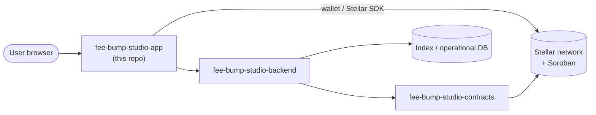

<div align="center">


# FeeBumpStudio App

*The user-facing fee-bump workflow for Stellar transactions* 🌊

[](LICENSE)
[](https://github.com/FeeBumpStudio/fee-bump-studio-app/actions/workflows/ci.yml)


</div>

---

## Why this exists

A developer workflow for **inspecting a transaction, estimating a replacement fee,
preparing fee-bump envelopes, and keeping the original transaction intent visible
for review**.

This repository is the **user-facing side** of FeeBumpStudio. It turns the protocol
behavior into a workflow that a person can inspect, understand, and test. It should
never hide important Stellar operations behind unexplained automation.

### Where this repo fits

| Repo | Role |
| --- | --- |
| **`fee-bump-studio-app`** (this repo) | Web application, integration client, user workflow |
| [`fee-bump-studio-contracts`](https://github.com/FeeBumpStudio/fee-bump-studio-contracts) | Soroban/Rust protocol layer and contract tests |
| [`fee-bump-studio-backend`](https://github.com/FeeBumpStudio/fee-bump-studio-backend) | Indexing, analysis, APIs, jobs, operational services |

## Features

- Clear display of the **current network and connection state** (Testnet by default)
- Explicit presentation of **the user action being performed**
- References to the relevant **Stellar transaction or contract** for every step
- Explicit **success, pending, and failure states**
- A readable **history of protocol events**
- Links to deeper **technical documentation**
- Every protocol action is **explained before wallet approval** is requested
- Errors preserve **enough context** to diagnose what happened

> ⚠️ **Status:** this is a development baseline. It is **not audited** and **not
> production-ready**. Do not use it with mainnet funds or production credentials.

## Architecture



The browser never contains server-side secrets. Network configuration belongs in
environment variables and deployment settings.

## Tech stack

| Layer | Technology |
| --- | --- |
| UI framework | [Next.js](https://nextjs.org) + React |
| Chain interaction | [@stellar/stellar-sdk](https://github.com/stellar/js-stellar-sdk) 17.2.1 |
| Network | Stellar Testnet (development default) |
| Language | TypeScript |

## Project structure

```text
fee-bump-studio-app/
├── app/            # Next.js app router (layout + pages)
├── assets/         # Banner and logo
├── docs/           # USER_FLOW and workflow notes
├── .env.example    # Environment variable template
└── .github/        # CI workflow
```

## Prerequisites

- Node.js ≥ 18
- npm (or pnpm)

## Installation

```bash
npm install
```

## Environment variables

Copy the template and fill in values:

```bash
cp .env.example .env.local
```

| Variable | Purpose |
| --- | --- |
| `STELLAR_NETWORK` | Which network the app targets (`testnet` by default) |
| `STELLAR_RPC_URL` | Soroban RPC endpoint URL (leave empty for the public Testnet default) |
| `STELLAR_CONTRACT_ID` | Deployed Soroban contract ID the app should interact with |

Do **not** paste production credentials into `.env.local`, and never commit `.env*`.
`.gitignore` explicitly excludes `.env`/`.env.*` while keeping `.env.example`.

## Running locally

```bash
npm run dev
```

## Testing

The CI workflow currently validates repository structure (README, SECURITY,
CONTRIBUTING). Add component tests as the workflow screens take shape:

```bash
npm run build   # Next.js type-checks the app during build
```

## Building / deploying

```bash
npm run build   # static/runtime build
npm start       # serve the production build
```

Deploy the Next.js app anywhere Node runs (Vercel, containers, self-hosted).
Ship only **public** network/contract config to the browser; keep server-side
secrets in deployment settings.

## Roadmap

- [ ] Replace the baseline screen with the project-specific workflow
- [ ] Add wallet connection
- [ ] Connect to the contract layer
- [ ] Add transaction status tracking
- [ ] Add error and retry states
- [ ] Add an end-to-end Testnet flow

## Contributing

Contributions are welcome! Please read [CONTRIBUTING.md](CONTRIBUTING.md) before
opening a PR.

## Security

Please report vulnerabilities privately instead of filing public issues — see
[SECURITY.md](SECURITY.md).

## Code of Conduct

Be kind and respectful. This project follows contributor norms of good conduct as
described in [CONTRIBUTING.md](CONTRIBUTING.md); a dedicated Code of Conduct file is
coming as the community grows.

## Maintainer

**Jubilee** ([@Jubilee-001](https://github.com/Jubilee-001))

## License

Distributed under the [MIT License](LICENSE).
