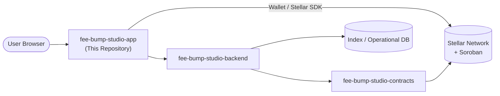

# FeeBumpStudio App

**The user-facing fee-bump workflow for Stellar transactions**

---

## Overview

FeeBumpStudio App is a developer-focused web application that provides a transparent workflow for:

- **Inspecting** Stellar transactions before signing
- **Estimating** replacement fees for fee-bump operations
- **Preparing** fee-bump envelopes with full visibility
- **Reviewing** original transaction intent at every step

The application treats Stellar as a verifiable settlement layer — never hiding important operations behind unexplained automation.

---

## Key Features

| Feature | Description |
|---------|-------------|
| **Network Awareness** | Clear display of current network (Testnet by default) and connection state |
| **Explicit Actions** | Every user action is presented clearly before wallet approval |
| **Transaction References** | Links to relevant Stellar transactions or contracts for every step |
| **State Visibility** | Success, pending, and failure states shown explicitly |
| **Event History** | Readable history of protocol events with deep links to documentation |
| **Error Context** | Errors preserve enough context to diagnose what happened |

---

## Project Status

> ⚠️ **Development Baseline** — This is **not audited** and **not production-ready**. Do not use with mainnet funds or production credentials.

---

## Quick Links

| Resource | Link |
|----------|------|
| **GitHub Repository** | [FeeBumpStudio/fee-bump-studio-app](https://github.com/FeeBumpStudio/fee-bump-studio-app) |
| **Issue Tracker** | [GitHub Issues](https://github.com/FeeBumpStudio/fee-bump-studio-app/issues) |
| **Security Policy** | [SECURITY.md](https://github.com/FeeBumpStudio/fee-bump-studio-app/blob/main/SECURITY.md) |
| **Contributing Guide** | [CONTRIBUTING.md](https://github.com/FeeBumpStudio/fee-bump-studio-app/blob/main/CONTRIBUTING.md) |
| **Backend Documentation** | [fee-bump-studio-backend docs](https://feebumpstudio.github.io/fee-bump-studio-backend/) |
| **Contracts Documentation** | [fee-bump-studio-contracts docs](https://feebumpstudio.github.io/fee-bump-studio-contracts/) |

---

## Architecture Overview



The browser never contains server-side secrets. Network configuration belongs in environment variables and deployment settings.

---

## Technology Stack

| Layer | Technology |
|-------|------------|
| **UI Framework** | [Next.js 15](https://nextjs.org) + [React 19](https://react.dev) |
| **Chain Interaction** | [@stellar/stellar-sdk](https://github.com/stellar/js-stellar-sdk) 17.2.1 |
| **Network** | Stellar Testnet (development default) |
| **Language** | TypeScript |
| **Build** | Next.js (static/runtime) |

---

## Getting Started

### Prerequisites

- **Node.js** ≥ 18
- **npm** (or pnpm)

### Installation

```bash
git clone https://github.com/FeeBumpStudio/fee-bump-studio-app.git
cd fee-bump-studio-app
npm install
```

### Configuration

```bash
cp .env.example .env.local
# Edit .env.local with your values
```

Required environment variables:

| Variable | Description | Default |
|----------|-------------|---------|
| `STELLAR_NETWORK` | Target network | `testnet` |
| `STELLAR_RPC_URL` | Soroban RPC endpoint | (public Testnet default) |
| `STELLAR_CONTRACT_ID` | Deployed contract ID | (required for contract features) |
| `PORT` | Dev server port | `3000` |

### Running Locally

```bash
npm run dev
```

Visit `http://localhost:3000` to see the application.

---

## Where This Repo Fits

| Repository | Role |
|------------|------|
| **`fee-bump-studio-app`** | Web application, integration client, user workflow |
| [`fee-bump-studio-contracts`](https://github.com/FeeBumpStudio/fee-bump-studio-contracts) | Soroban/Rust protocol layer and contract tests |
| [`fee-bump-studio-backend`](https://github.com/FeeBumpStudio/fee-bump-studio-backend) | Indexing, analysis, APIs, jobs, operational services |

---

## Maintainer

**Jubilee** ([@Jubilee-001](https://github.com/Jubilee-001))

---

## License

Distributed under the [MIT License](https://github.com/FeeBumpStudio/fee-bump-studio-app/blob/main/LICENSE).