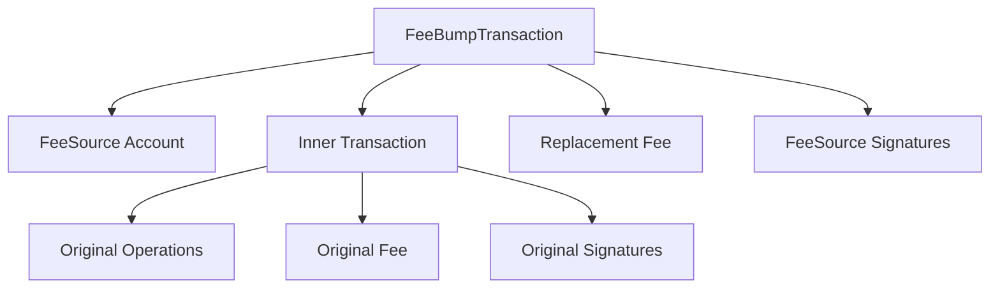
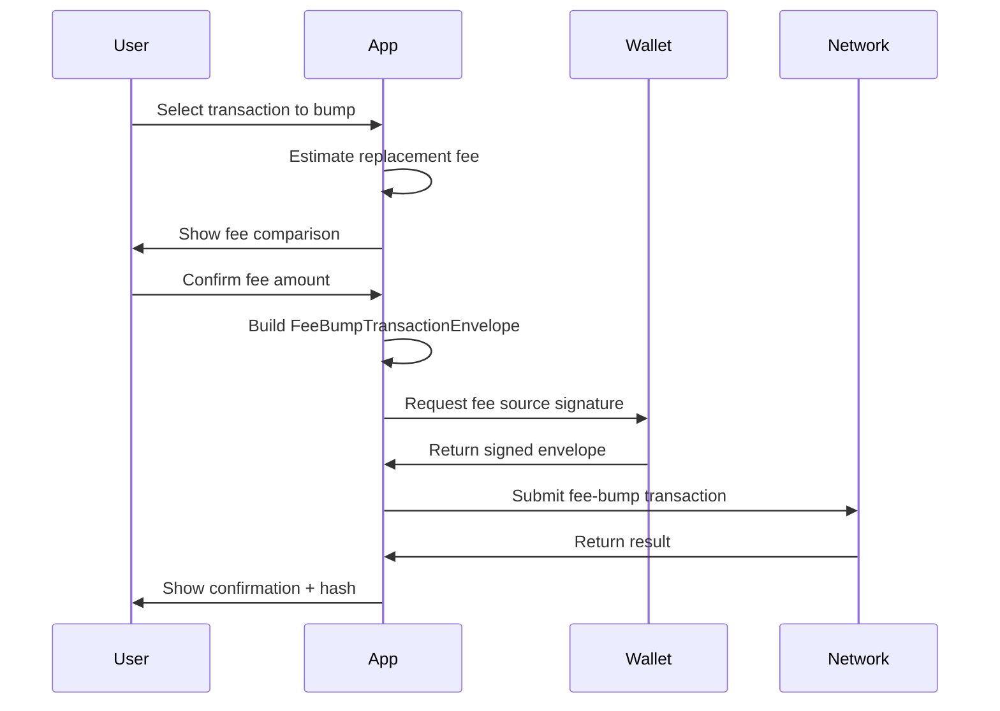

# Fee-Bump Preparation

## Overview

Fee-bump preparation creates a valid fee-bump transaction envelope that:

1. **Wraps** the original transaction
2. **Replaces** the fee with a higher amount
3. **Preserves** all original operations and intent
4. **Requires** authorization from the fee source account

## Current Status

> 🚧 **Planned Feature** — Core feature, not yet implemented.

## Fee-Bump Transaction Structure



### Key Properties

| Property | Description |
|----------|-------------|
| **Fee Source** | Account paying the bump fee (can differ from inner source) |
| **Inner Transaction** | The original transaction being bumped |
| **Replacement Fee** | New fee bid (must exceed inner fee) |
| **Signatures** | Fee source must sign; inner signatures preserved |

## Preparation Workflow



## Validation Rules

The app validates before submission:

1. ✅ Replacement fee > inner transaction fee
2. ✅ Fee source account exists and has balance
3. ✅ Inner transaction is valid XDR
4. ✅ Fee source has authorized (via wallet)
4. ✅ Network supports fee-bump (protocol v20+)

## Contract Fee-Bumps

For Soroban contract transactions:

- Inner transaction contains `InvokeHostFunction` operations
- Fee source may be different from contract caller
- Contract authorization preserved in inner transaction
- Simulation recommended before bumping

## UI Flow (Planned)

```
┌─────────────────────────────────────────────────────┐
│ Prepare Fee Bump                                    │
├─────────────────────────────────────────────────────┤
│ Inner Transaction: a1b2c3... (View Details)        │
│ Original Fee:  1,000,000 stroops                   │
├─────────────────────────────────────────────────────┤
│ Fee Source Account: GABC...XYZ (balance: 100 XLM)  │
│ Replacement Fee: [2,000,000] stroops  ▼            │
│                       │                             │
│  Suggested: 2,000,000  │  Conservative: 5,000,000  │
├─────────────────────────────────────────────────────┤
│ ⚠️ Fee source must sign. Inner signatures kept.    │
│ [Prepare & Sign with Wallet]                        │
└─────────────────────────────────────────────────────┘
```

## Error Handling

| Error | Cause | Resolution |
|-------|-------|------------|
| `FEE_TOO_LOW` | Replacement ≤ original | Increase replacement fee |
| `INSUFFICIENT_BALANCE` | Fee source lacks XLM | Fund fee source account |
| `INVALID_INNER_TX` | Malformed inner XDR | Re-inspect original transaction |
| `NETWORK_UNSUPPORTED` | Protocol < v20 | Upgrade network or use different approach |

## Related Documentation

- [Fee Estimation](fee-estimation.md)
- [Transaction Inspection](transaction-inspection.md)
- [Contract Interaction](../api-reference/contract-interaction.md)
- [Stellar Fee-Bump Docs](https://developers.stellar.org/docs/encyclopedia/fee-bump-transactions)