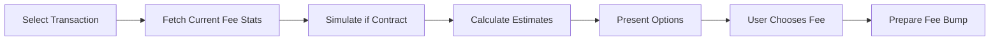

# Fee Estimation

## Overview

Fee estimation calculates the appropriate replacement fee for a fee-bump transaction based on:

- Current network fee dynamics
- Transaction complexity (operations, contract calls)
- Desired inclusion probability
- Time sensitivity

## Current Status

> 🚧 **Planned Feature** — Requires backend indexer and contract integration.

## Fee Models

### Stellar Base Fee

The network minimum fee per operation:

```
base_fee = 100 stroops (0.00001 XLM) per operation
```

### Fee-Bump Replacement Fee

Must exceed the original transaction's fee bid:

```
replacement_fee > original_fee * 1.1  // At least 10% higher
```

### Dynamic Estimation Factors

| Factor | Weight | Description |
|--------|--------|-------------|
| **Network congestion** | High | Recent ledger fee stats |
| **Operation count** | Medium | More operations = higher fee |
| **Contract complexity** | High | Wasm execution costs |
| **Inclusion urgency** | User-defined | Next ledger vs. within N ledgers |

## Planned API

```typescript
interface FeeEstimate {
  minFee: bigint;           // Network minimum
  recommendedFee: bigint;   // Suggested for next-ledger inclusion
  conservativeFee: bigint;  // High confidence inclusion
  estimatedLedgers: number; // Expected inclusion time
  breakdown: FeeBreakdown;  // Per-operation analysis
}

interface FeeBreakdown {
  baseFee: bigint;
  operationFees: OperationFee[];
  contractFees: ContractFee[];
  surgeMultiplier: number;
}
```

## Estimation Sources

| Source | Method | Reliability |
|--------|--------|-------------|
| **RPC `getFeeStats`** | Recent ledger fees | High (real-time) |
| **Backend indexer** | Historical analysis | High (aggregated) |
| **Contract simulation** | `simulateTransaction` | Highest (exact) |
| **Static fallback** | Configured defaults | Low (safe minimum) |

## User Workflow



## Configuration

Estimation behavior configurable via environment:

```ini
# .env.local
FEE_ESTIMATION_MODE=conservative  # conservative | recommended | aggressive
FEE_SURGE_MULTIPLIER=1.5          # Multiplier for network congestion
FEE_MAX_LEDGERS=5                 # Max ledgers for inclusion target
```

## Related Documentation

- [Transaction Inspection](transaction-inspection.md)
- [Fee-Bump Preparation](fee-bump-preparation.md)
- [Backend API](../api-reference/backend-api.md)