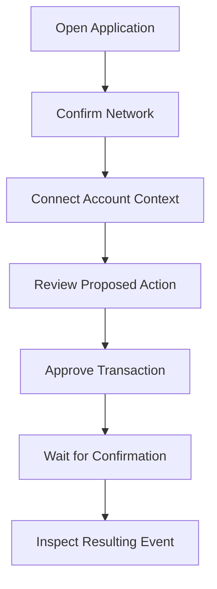

# User Guide Overview

## Workflow Philosophy

FeeBumpStudio App follows a **transparent, explicit** workflow:

1. **Show** — Display what the user is about to do
2. **Explain** — Provide context and references
3. **Confirm** — Request explicit approval before any blockchain action
4. **Track** — Show status and history after submission

This approach ensures developers and users always understand what's happening on-chain.

## Core Workflow Steps

### Step Details

| Step | Description | Key UI Elements |
|------|-------------|-----------------|
| **1. Open** | Launch the app in browser | Network indicator, version |
| **2. Network** | Verify Testnet/Mainnet | Network badge, RPC status |
| **3. Account** | Provide source account | Address display, balance (if available) |
| **4. Review** | Inspect transaction details | Fee estimate, operations, references |
| **5. Approve** | Sign with wallet | Wallet prompt, explicit action description |
| **6. Confirm** | Wait for ledger inclusion | Transaction hash, ledger link, status |
| **7. Inspect** | View event/record | Event details, contract state, explorer links |

## Feature Status

| Feature | Status | Notes |
|---------|--------|-------|
| Network display | ✅ Baseline | Shows Testnet by default |
| Account context | 🚧 Planned | Wallet connection coming |
| Transaction inspection | 🚧 Planned | Requires backend integration |
| Fee estimation | 🚧 Planned | Requires contract + backend |
| Fee-bump preparation | 🚧 Planned | Core feature, not yet implemented |
| History/events | 🚧 Planned | Requires backend indexer |

> See [Roadmap](https://github.com/FeeBumpStudio/fee-bump-studio-app/blob/main/README.md#roadmap) for planned features.

## Navigation

The baseline app is a single page. As features are added, navigation will include:

- **Dashboard** — Overview and quick actions
- **Transactions** — List, inspect, prepare fee-bumps
- **Contracts** — Contract interaction and state
- **History** — Event log and audit trail
- **Settings** — Network, RPC, wallet preferences

## Keyboard Shortcuts

| Shortcut | Action |
|----------|--------|
| `Cmd/Ctrl + K` | Command palette (planned) |
| `Cmd/Ctrl + Shift + N` | Switch network (planned) |
| `?` | Help dialog (planned) |

## Accessibility

The application aims for WCAG 2.1 AA compliance:

- Semantic HTML structure
- Keyboard navigation
- Sufficient color contrast
- Screen reader labels
- Focus indicators

Report accessibility issues via [GitHub Issues](https://github.com/FeeBumpStudio/fee-bump-studio-app/issues).